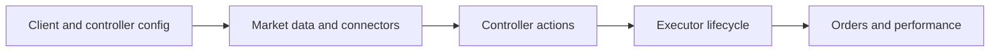
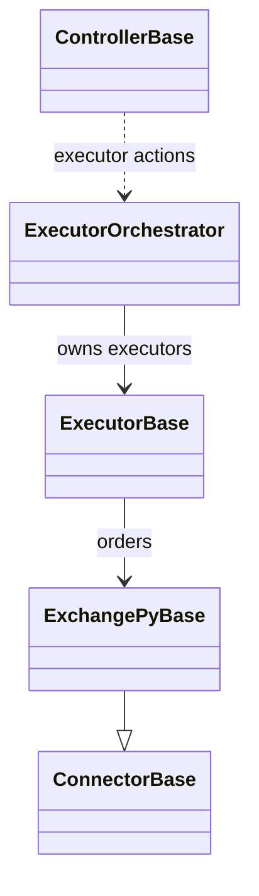
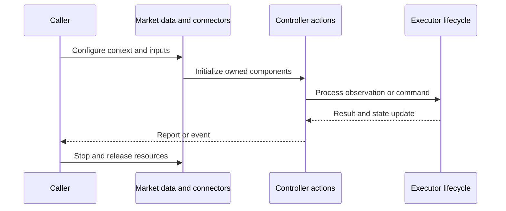
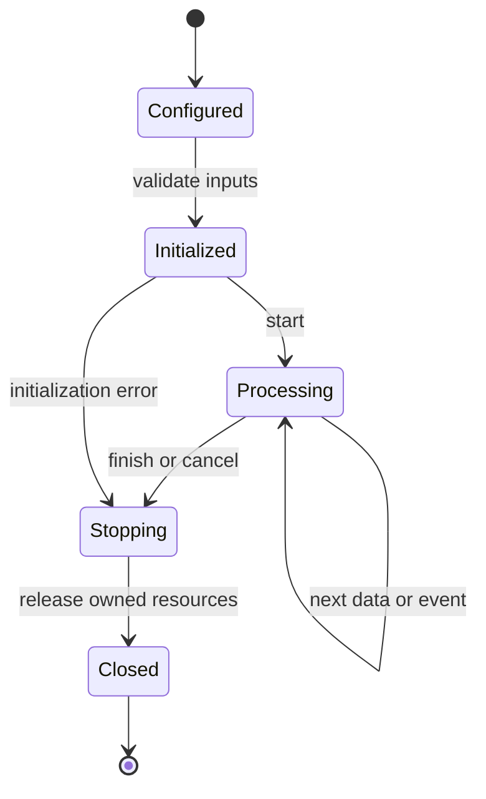
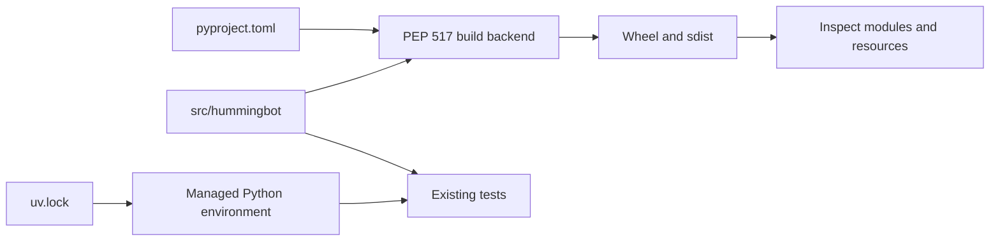
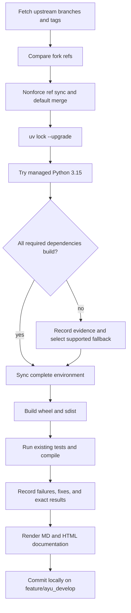

# hummingbot: architecture and development

Hummingbot provides market-making/arbitrage connectors and strategy execution, with a native Cython/C++ market-data/order core and a Python strategy/controller layer.

## Components and boundaries

ConnectorBase defines exchange operations; ExchangePyBase adds common asynchronous REST/websocket behavior. OrderBook and Clock are compiled core types. Strategy V2 ControllerBase processes market data and produces executor actions; ExecutorBase owns an execution lifecycle, with position, grid, arbitrage, DCA and order variants. ExecutorOrchestrator manages executor actions and reporting. The CLI/client assembles connectors, configuration, and scripts.

The following class view names implementation classes. Cross-package types are supplied by the host ecosystem; arrows describe inheritance or usage, not copied ownership.

## Runtime workflow

Load client/controller configuration, create connectors and market data, advance the clock, let controllers compute executor actions, create or update executors, place/reconcile orders through connectors, and record performance. REST/websocket events update order-book and in-flight-order state. Shutdown cancels owned tasks and closes connectors.

This sequence is an architectural view of responsibility and resource ownership. Individual plugin, connector, and strategy implementations can add asynchronous events and error branches. The lifecycle below is a conceptual operating workflow, rather than a claim that every component has one shared state enum.

## Features and extension points

CEX and Gateway connectors; compiled order books and clocks; Strategy V2 controllers/executors; legacy strategies; order tracking; market-making and arbitrage scripts; client configuration and command UI.

Extend the owning component behind its existing public interface. Keep metadata and configuration alongside plugin/strategy resources. Exchange-specific behavior belongs in an adapter; strategy decisions belong in the strategy/evaluator layer; persistence schema and migrations belong with the storage implementation. Review the source map below before changing a boundary, and exercise the existing tests associated with that boundary.

## Packaging and dependency design

The src migration was incomplete before maintenance; 862 missing upstream source/resource files were restored. The final native build contains 61 shared modules and 902 Python modules. Setuptools/Cython remains the native build backend. The licensed ft-pandas-ta compatibility source supplies the pandas_ta namespace with current NumPy support and two Python 3.15 compiler repairs; an exact upstream coincurve Git revision includes its current CFFI license-layout build correction. Python 3.15 builds after installing native TA-Lib headers and replacing removed PyWeakref_GetObject calls with standard weak-reference calls. Final verification details are recorded in validation.md.

The lock records exact package versions, hashes, platform markers, and local source mappings. Path sources deliberately bind related repositories in this workspace; clone sibling repositories at the documented names before synchronization. Published packaging metadata describes public dependencies, while uv source settings select this development workspace. Resolve dependency changes with uv lock --upgrade and retain the generated lock, then verify the same locked environment.

## Maintenance workflow

All upstream branches and tags are fetched. Fork updates use nonforce pushes; a divergent branch is merged without erasing fork history. The default branch is merged into feature/ayu_develop with package/resource conflicts reconciled in their installed locations. Build and test evidence is recorded before a local maintenance commit. Feature branch publication is a separate root-level action.

No existing test assertions are removed and no new test cases are introduced in this maintenance pass. Corrected fixtures preserve coverage while making paths, corruption inputs, and resource cleanup compatible with the selected interpreter. A failed test or unsupported dependency is reported explicitly in [validation](validation.md); package build success does not imply strategy correctness, profitability, or successful live connectivity.

## Source map

| Source | Responsibility and location |
| --- | --- |
| [connector_base.pyx](../src/hummingbot/connector/connector_base.pyx) | src/hummingbot/connector/connector_base.pyx |
| [exchange_py_base.py](../src/hummingbot/connector/exchange_py_base.py) | src/hummingbot/connector/exchange_py_base.py |
| [order_book.pyx](../src/hummingbot/core/data_type/order_book.pyx) | src/hummingbot/core/data_type/order_book.pyx |
| [clock.pyx](../src/hummingbot/core/clock.pyx) | src/hummingbot/core/clock.pyx |
| [in_flight_order.py](../src/hummingbot/core/data_type/in_flight_order.py) | src/hummingbot/core/data_type/in_flight_order.py |
| [controller_base.py](../src/hummingbot/strategy_v2/controllers/controller_base.py) | src/hummingbot/strategy_v2/controllers/controller_base.py |
| [executor_base.py](../src/hummingbot/strategy_v2/executors/executor_base.py) | src/hummingbot/strategy_v2/executors/executor_base.py |
| [executor_orchestrator.py](../src/hummingbot/strategy_v2/executors/executor_orchestrator.py) | src/hummingbot/strategy_v2/executors/executor_orchestrator.py |
| [hummingbot_application.py](../src/hummingbot/client/hummingbot_application.py) | src/hummingbot/client/hummingbot_application.py |
| [market_data_provider.py](../src/hummingbot/data_feed/market_data_provider.py) | src/hummingbot/data_feed/market_data_provider.py |
| [pyproject.toml](../pyproject.toml) | pyproject.toml |
| [uv.lock](../uv.lock) | uv.lock |
| [README.md](../README.md) | README.md |
| [setup.py](../setup.py) | setup.py |

## Further reading

Use [development.md](development.md) for reproducible commands and [validation.md](validation.md) for exact interpreter, dependency, build, test, and blocker evidence. The equivalent [HTML architecture document](ayu-develop.html) supports browsing and rendered diagrams.
