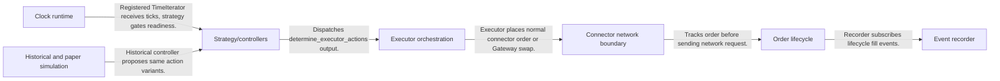
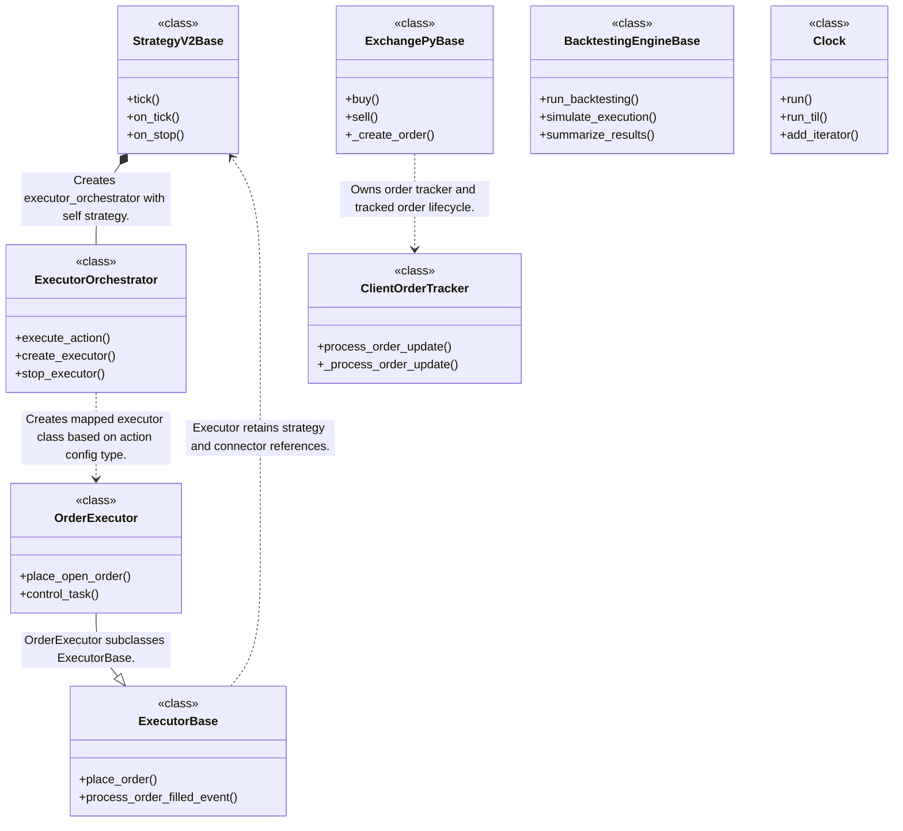
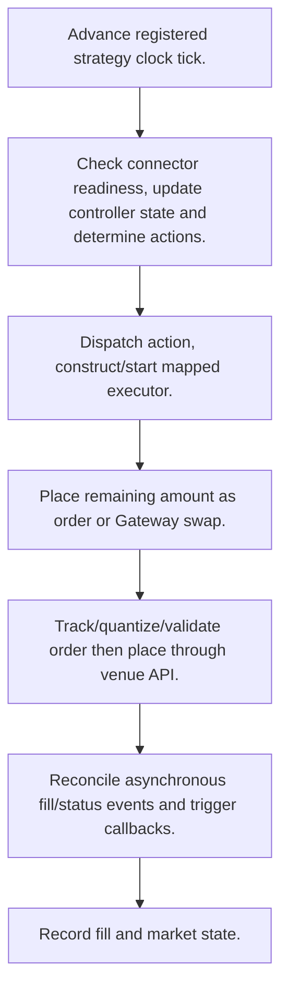
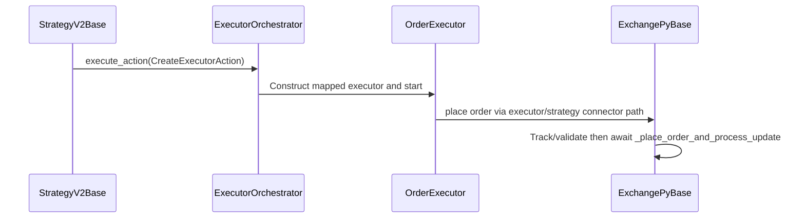

# hummingbot: workflow, design and architecture

Updated: **2026-10-13**
Reviewed Git hash: `da0a8b367b74a6bf576ecffa61a3299de3374c6e`
Branch: `feature/ayu_develop`
Source diff SHA256: `e3b0c44298fc1c149afbf4c8996fb92427ae41e4649b934ca495991b7852b855`
Scope: **Event-driven crypto execution / market-making framework** / Maintenance: **active**
Languages: Python, Cython, C++

[HTML edition](ayu-develop.html) / [Development](development.md) / [Historical validation](validation.md) / [Full system comparison](../../docs/index.html)

## Purpose and scope

Drive connector-backed trading strategies with clock/event lifecycle, compose controller/executor actions and simulate supported V2 executors over historical candles.

## Features and support boundaries

Native = implemented here. Integration = supplied through a named host/API. Limited = material restriction. Not provided = evidenced scope exclusion. Unverified = support/absence not established. Not applicable = outside this artifact type.

| Capability | Status | Implementation and limits | Source |
|---|---|---|---|
| Backtesting | Native | V2 backtesting loads historical candles, iterates controller actions and returns executor/position/PnL summaries. Support is controller/executor-specific. | [BacktestingEngineBase.run_backtesting](../src/hummingbot/strategy_v2/backtesting/backtesting_engine_base.py) ([L221](https://github.com/alexcwyu/hummingbot/blob/da0a8b367b74a6bf576ecffa61a3299de3374c6e/src/hummingbot/strategy_v2/backtesting/backtesting_engine_base.py#L221)) / [BacktestingEngineBase.simulate_execution](../src/hummingbot/strategy_v2/backtesting/backtesting_engine_base.py) ([L269](https://github.com/alexcwyu/hummingbot/blob/da0a8b367b74a6bf576ecffa61a3299de3374c6e/src/hummingbot/strategy_v2/backtesting/backtesting_engine_base.py#L269)) |
| Live execution | Native | Clock/executors/connectors/tracker/paper budget/order validation and recorder implement native framework behavior; exchange availability remains an external requirement. | [Clock.run_til](../src/hummingbot/core/clock.pyx) ([L88](https://github.com/alexcwyu/hummingbot/blob/da0a8b367b74a6bf576ecffa61a3299de3374c6e/src/hummingbot/core/clock.pyx#L88)) / [StrategyV2Base.on_tick](../src/hummingbot/strategy/strategy_v2_base.py) ([L312](https://github.com/alexcwyu/hummingbot/blob/da0a8b367b74a6bf576ecffa61a3299de3374c6e/src/hummingbot/strategy/strategy_v2_base.py#L312)) / [OrderExecutor.place_open_order](../src/hummingbot/strategy_v2/executors/order_executor/order_executor.py) ([L232](https://github.com/alexcwyu/hummingbot/blob/da0a8b367b74a6bf576ecffa61a3299de3374c6e/src/hummingbot/strategy_v2/executors/order_executor/order_executor.py#L232)) / [ExchangePyBase._create_order](../src/hummingbot/connector/exchange_py_base.py) ([L400](https://github.com/alexcwyu/hummingbot/blob/da0a8b367b74a6bf576ecffa61a3299de3374c6e/src/hummingbot/connector/exchange_py_base.py#L400)) / [ClientOrderTracker._process_order_update](../src/hummingbot/connector/client_order_tracker.py) ([L267](https://github.com/alexcwyu/hummingbot/blob/da0a8b367b74a6bf576ecffa61a3299de3374c6e/src/hummingbot/connector/client_order_tracker.py#L267)) / [MarketsRecorder._did_fill_order](../src/hummingbot/connector/markets_recorder.py) ([L400](https://github.com/alexcwyu/hummingbot/blob/da0a8b367b74a6bf576ecffa61a3299de3374c6e/src/hummingbot/connector/markets_recorder.py#L400)) / [main](../src/hummingbot/client/interactive.py) ([L80](https://github.com/alexcwyu/hummingbot/blob/da0a8b367b74a6bf576ecffa61a3299de3374c6e/src/hummingbot/client/interactive.py#L80)) |
| Paper trading | Native | PaperTradeExchange implements balances, delayed market order queue and orderbook-driven simulated lifecycle. | [PaperTradeExchange](../src/hummingbot/connector/exchange/paper_trade/paper_trade_exchange.pyx) ([L143](https://github.com/alexcwyu/hummingbot/blob/da0a8b367b74a6bf576ecffa61a3299de3374c6e/src/hummingbot/connector/exchange/paper_trade/paper_trade_exchange.pyx#L143)) / [c_process_market_orders](../src/hummingbot/connector/exchange/paper_trade/paper_trade_exchange.pyx) ([L609](https://github.com/alexcwyu/hummingbot/blob/da0a8b367b74a6bf576ecffa61a3299de3374c6e/src/hummingbot/connector/exchange/paper_trade/paper_trade_exchange.pyx#L609)) |
| Event driven | Native | Clock/executors/connectors/tracker/paper budget/order validation and recorder implement native framework behavior; exchange availability remains an external requirement. | [Clock.run_til](../src/hummingbot/core/clock.pyx) ([L88](https://github.com/alexcwyu/hummingbot/blob/da0a8b367b74a6bf576ecffa61a3299de3374c6e/src/hummingbot/core/clock.pyx#L88)) / [StrategyV2Base.on_tick](../src/hummingbot/strategy/strategy_v2_base.py) ([L312](https://github.com/alexcwyu/hummingbot/blob/da0a8b367b74a6bf576ecffa61a3299de3374c6e/src/hummingbot/strategy/strategy_v2_base.py#L312)) / [OrderExecutor.place_open_order](../src/hummingbot/strategy_v2/executors/order_executor/order_executor.py) ([L232](https://github.com/alexcwyu/hummingbot/blob/da0a8b367b74a6bf576ecffa61a3299de3374c6e/src/hummingbot/strategy_v2/executors/order_executor/order_executor.py#L232)) / [ExchangePyBase._create_order](../src/hummingbot/connector/exchange_py_base.py) ([L400](https://github.com/alexcwyu/hummingbot/blob/da0a8b367b74a6bf576ecffa61a3299de3374c6e/src/hummingbot/connector/exchange_py_base.py#L400)) / [ClientOrderTracker._process_order_update](../src/hummingbot/connector/client_order_tracker.py) ([L267](https://github.com/alexcwyu/hummingbot/blob/da0a8b367b74a6bf576ecffa61a3299de3374c6e/src/hummingbot/connector/client_order_tracker.py#L267)) / [MarketsRecorder._did_fill_order](../src/hummingbot/connector/markets_recorder.py) ([L400](https://github.com/alexcwyu/hummingbot/blob/da0a8b367b74a6bf576ecffa61a3299de3374c6e/src/hummingbot/connector/markets_recorder.py#L400)) / [main](../src/hummingbot/client/interactive.py) ([L80](https://github.com/alexcwyu/hummingbot/blob/da0a8b367b74a6bf576ecffa61a3299de3374c6e/src/hummingbot/client/interactive.py#L80)) |
| Vectorized | Limited | Historical feature DataFrames prepare market data but simulation iterates rows and stateful executor actions. | [BacktestingEngineBase.simulate_execution](../src/hummingbot/strategy_v2/backtesting/backtesting_engine_base.py) ([L269](https://github.com/alexcwyu/hummingbot/blob/da0a8b367b74a6bf576ecffa61a3299de3374c6e/src/hummingbot/strategy_v2/backtesting/backtesting_engine_base.py#L269)) |
| Order management | Native | Clock/executors/connectors/tracker/paper budget/order validation and recorder implement native framework behavior; exchange availability remains an external requirement. | [Clock.run_til](../src/hummingbot/core/clock.pyx) ([L88](https://github.com/alexcwyu/hummingbot/blob/da0a8b367b74a6bf576ecffa61a3299de3374c6e/src/hummingbot/core/clock.pyx#L88)) / [StrategyV2Base.on_tick](../src/hummingbot/strategy/strategy_v2_base.py) ([L312](https://github.com/alexcwyu/hummingbot/blob/da0a8b367b74a6bf576ecffa61a3299de3374c6e/src/hummingbot/strategy/strategy_v2_base.py#L312)) / [OrderExecutor.place_open_order](../src/hummingbot/strategy_v2/executors/order_executor/order_executor.py) ([L232](https://github.com/alexcwyu/hummingbot/blob/da0a8b367b74a6bf576ecffa61a3299de3374c6e/src/hummingbot/strategy_v2/executors/order_executor/order_executor.py#L232)) / [ExchangePyBase._create_order](../src/hummingbot/connector/exchange_py_base.py) ([L400](https://github.com/alexcwyu/hummingbot/blob/da0a8b367b74a6bf576ecffa61a3299de3374c6e/src/hummingbot/connector/exchange_py_base.py#L400)) / [ClientOrderTracker._process_order_update](../src/hummingbot/connector/client_order_tracker.py) ([L267](https://github.com/alexcwyu/hummingbot/blob/da0a8b367b74a6bf576ecffa61a3299de3374c6e/src/hummingbot/connector/client_order_tracker.py#L267)) / [MarketsRecorder._did_fill_order](../src/hummingbot/connector/markets_recorder.py) ([L400](https://github.com/alexcwyu/hummingbot/blob/da0a8b367b74a6bf576ecffa61a3299de3374c6e/src/hummingbot/connector/markets_recorder.py#L400)) / [main](../src/hummingbot/client/interactive.py) ([L80](https://github.com/alexcwyu/hummingbot/blob/da0a8b367b74a6bf576ecffa61a3299de3374c6e/src/hummingbot/client/interactive.py#L80)) |
| Order types | Native | Clock/executors/connectors/tracker/paper budget/order validation and recorder implement native framework behavior; exchange availability remains an external requirement. | [Clock.run_til](../src/hummingbot/core/clock.pyx) ([L88](https://github.com/alexcwyu/hummingbot/blob/da0a8b367b74a6bf576ecffa61a3299de3374c6e/src/hummingbot/core/clock.pyx#L88)) / [StrategyV2Base.on_tick](../src/hummingbot/strategy/strategy_v2_base.py) ([L312](https://github.com/alexcwyu/hummingbot/blob/da0a8b367b74a6bf576ecffa61a3299de3374c6e/src/hummingbot/strategy/strategy_v2_base.py#L312)) / [OrderExecutor.place_open_order](../src/hummingbot/strategy_v2/executors/order_executor/order_executor.py) ([L232](https://github.com/alexcwyu/hummingbot/blob/da0a8b367b74a6bf576ecffa61a3299de3374c6e/src/hummingbot/strategy_v2/executors/order_executor/order_executor.py#L232)) / [ExchangePyBase._create_order](../src/hummingbot/connector/exchange_py_base.py) ([L400](https://github.com/alexcwyu/hummingbot/blob/da0a8b367b74a6bf576ecffa61a3299de3374c6e/src/hummingbot/connector/exchange_py_base.py#L400)) / [ClientOrderTracker._process_order_update](../src/hummingbot/connector/client_order_tracker.py) ([L267](https://github.com/alexcwyu/hummingbot/blob/da0a8b367b74a6bf576ecffa61a3299de3374c6e/src/hummingbot/connector/client_order_tracker.py#L267)) / [MarketsRecorder._did_fill_order](../src/hummingbot/connector/markets_recorder.py) ([L400](https://github.com/alexcwyu/hummingbot/blob/da0a8b367b74a6bf576ecffa61a3299de3374c6e/src/hummingbot/connector/markets_recorder.py#L400)) / [main](../src/hummingbot/client/interactive.py) ([L80](https://github.com/alexcwyu/hummingbot/blob/da0a8b367b74a6bf576ecffa61a3299de3374c6e/src/hummingbot/client/interactive.py#L80)) |
| Multi venue | Integration | Strategies accept multiple connector instances; actual spot/perpetual/venue feeds/auth/rules depend on concrete exchange connectors. | [StrategyV2Base.__init__](../src/hummingbot/strategy/strategy_v2_base.py) ([L256](https://github.com/alexcwyu/hummingbot/blob/da0a8b367b74a6bf576ecffa61a3299de3374c6e/src/hummingbot/strategy/strategy_v2_base.py#L256)) / [BinancePerpetualDerivative](../src/hummingbot/connector/derivative/binance_perpetual/binance_perpetual_derivative.py) ([L38](https://github.com/alexcwyu/hummingbot/blob/da0a8b367b74a6bf576ecffa61a3299de3374c6e/src/hummingbot/connector/derivative/binance_perpetual/binance_perpetual_derivative.py#L38)) / [ExchangePyBase._create_order](../src/hummingbot/connector/exchange_py_base.py) ([L400](https://github.com/alexcwyu/hummingbot/blob/da0a8b367b74a6bf576ecffa61a3299de3374c6e/src/hummingbot/connector/exchange_py_base.py#L400)) |
| Crypto | Integration | Strategies accept multiple connector instances; actual spot/perpetual/venue feeds/auth/rules depend on concrete exchange connectors. | [StrategyV2Base.__init__](../src/hummingbot/strategy/strategy_v2_base.py) ([L256](https://github.com/alexcwyu/hummingbot/blob/da0a8b367b74a6bf576ecffa61a3299de3374c6e/src/hummingbot/strategy/strategy_v2_base.py#L256)) / [BinancePerpetualDerivative](../src/hummingbot/connector/derivative/binance_perpetual/binance_perpetual_derivative.py) ([L38](https://github.com/alexcwyu/hummingbot/blob/da0a8b367b74a6bf576ecffa61a3299de3374c6e/src/hummingbot/connector/derivative/binance_perpetual/binance_perpetual_derivative.py#L38)) / [ExchangePyBase._create_order](../src/hummingbot/connector/exchange_py_base.py) ([L400](https://github.com/alexcwyu/hummingbot/blob/da0a8b367b74a6bf576ecffa61a3299de3374c6e/src/hummingbot/connector/exchange_py_base.py#L400)) |
| Equities | Unverified | Representative source review did not establish this capability; no claim of absence. | Not applicable to this repository scope. |
| Futures | Integration | Strategies accept multiple connector instances; actual spot/perpetual/venue feeds/auth/rules depend on concrete exchange connectors. | [StrategyV2Base.__init__](../src/hummingbot/strategy/strategy_v2_base.py) ([L256](https://github.com/alexcwyu/hummingbot/blob/da0a8b367b74a6bf576ecffa61a3299de3374c6e/src/hummingbot/strategy/strategy_v2_base.py#L256)) / [BinancePerpetualDerivative](../src/hummingbot/connector/derivative/binance_perpetual/binance_perpetual_derivative.py) ([L38](https://github.com/alexcwyu/hummingbot/blob/da0a8b367b74a6bf576ecffa61a3299de3374c6e/src/hummingbot/connector/derivative/binance_perpetual/binance_perpetual_derivative.py#L38)) / [ExchangePyBase._create_order](../src/hummingbot/connector/exchange_py_base.py) ([L400](https://github.com/alexcwyu/hummingbot/blob/da0a8b367b74a6bf576ecffa61a3299de3374c6e/src/hummingbot/connector/exchange_py_base.py#L400)) |
| Options | Unverified | Representative source review did not establish this capability; no claim of absence. | Not applicable to this repository scope. |
| Forex | Unverified | Representative source review did not establish this capability; no claim of absence. | Not applicable to this repository scope. |
| Strategy api | Native | Clock/executors/connectors/tracker/paper budget/order validation and recorder implement native framework behavior; exchange availability remains an external requirement. | [Clock.run_til](../src/hummingbot/core/clock.pyx) ([L88](https://github.com/alexcwyu/hummingbot/blob/da0a8b367b74a6bf576ecffa61a3299de3374c6e/src/hummingbot/core/clock.pyx#L88)) / [StrategyV2Base.on_tick](../src/hummingbot/strategy/strategy_v2_base.py) ([L312](https://github.com/alexcwyu/hummingbot/blob/da0a8b367b74a6bf576ecffa61a3299de3374c6e/src/hummingbot/strategy/strategy_v2_base.py#L312)) / [OrderExecutor.place_open_order](../src/hummingbot/strategy_v2/executors/order_executor/order_executor.py) ([L232](https://github.com/alexcwyu/hummingbot/blob/da0a8b367b74a6bf576ecffa61a3299de3374c6e/src/hummingbot/strategy_v2/executors/order_executor/order_executor.py#L232)) / [ExchangePyBase._create_order](../src/hummingbot/connector/exchange_py_base.py) ([L400](https://github.com/alexcwyu/hummingbot/blob/da0a8b367b74a6bf576ecffa61a3299de3374c6e/src/hummingbot/connector/exchange_py_base.py#L400)) / [ClientOrderTracker._process_order_update](../src/hummingbot/connector/client_order_tracker.py) ([L267](https://github.com/alexcwyu/hummingbot/blob/da0a8b367b74a6bf576ecffa61a3299de3374c6e/src/hummingbot/connector/client_order_tracker.py#L267)) / [MarketsRecorder._did_fill_order](../src/hummingbot/connector/markets_recorder.py) ([L400](https://github.com/alexcwyu/hummingbot/blob/da0a8b367b74a6bf576ecffa61a3299de3374c6e/src/hummingbot/connector/markets_recorder.py#L400)) / [main](../src/hummingbot/client/interactive.py) ([L80](https://github.com/alexcwyu/hummingbot/blob/da0a8b367b74a6bf576ecffa61a3299de3374c6e/src/hummingbot/client/interactive.py#L80)) |
| Optimization | Unverified | Representative source review did not establish this capability; no claim of absence. | Not applicable to this repository scope. |
| Machine learning | Unverified | Representative source review did not establish this capability; no claim of absence. | Not applicable to this repository scope. |
| Reinforcement learning | Unverified | Representative source review did not establish this capability; no claim of absence. | Not applicable to this repository scope. |
| Portfolio | Native | Clock/executors/connectors/tracker/paper budget/order validation and recorder implement native framework behavior; exchange availability remains an external requirement. | [Clock.run_til](../src/hummingbot/core/clock.pyx) ([L88](https://github.com/alexcwyu/hummingbot/blob/da0a8b367b74a6bf576ecffa61a3299de3374c6e/src/hummingbot/core/clock.pyx#L88)) / [StrategyV2Base.on_tick](../src/hummingbot/strategy/strategy_v2_base.py) ([L312](https://github.com/alexcwyu/hummingbot/blob/da0a8b367b74a6bf576ecffa61a3299de3374c6e/src/hummingbot/strategy/strategy_v2_base.py#L312)) / [OrderExecutor.place_open_order](../src/hummingbot/strategy_v2/executors/order_executor/order_executor.py) ([L232](https://github.com/alexcwyu/hummingbot/blob/da0a8b367b74a6bf576ecffa61a3299de3374c6e/src/hummingbot/strategy_v2/executors/order_executor/order_executor.py#L232)) / [ExchangePyBase._create_order](../src/hummingbot/connector/exchange_py_base.py) ([L400](https://github.com/alexcwyu/hummingbot/blob/da0a8b367b74a6bf576ecffa61a3299de3374c6e/src/hummingbot/connector/exchange_py_base.py#L400)) / [ClientOrderTracker._process_order_update](../src/hummingbot/connector/client_order_tracker.py) ([L267](https://github.com/alexcwyu/hummingbot/blob/da0a8b367b74a6bf576ecffa61a3299de3374c6e/src/hummingbot/connector/client_order_tracker.py#L267)) / [MarketsRecorder._did_fill_order](../src/hummingbot/connector/markets_recorder.py) ([L400](https://github.com/alexcwyu/hummingbot/blob/da0a8b367b74a6bf576ecffa61a3299de3374c6e/src/hummingbot/connector/markets_recorder.py#L400)) / [main](../src/hummingbot/client/interactive.py) ([L80](https://github.com/alexcwyu/hummingbot/blob/da0a8b367b74a6bf576ecffa61a3299de3374c6e/src/hummingbot/client/interactive.py#L80)) |
| Risk management | Native | Clock/executors/connectors/tracker/paper budget/order validation and recorder implement native framework behavior; exchange availability remains an external requirement. | [Clock.run_til](../src/hummingbot/core/clock.pyx) ([L88](https://github.com/alexcwyu/hummingbot/blob/da0a8b367b74a6bf576ecffa61a3299de3374c6e/src/hummingbot/core/clock.pyx#L88)) / [StrategyV2Base.on_tick](../src/hummingbot/strategy/strategy_v2_base.py) ([L312](https://github.com/alexcwyu/hummingbot/blob/da0a8b367b74a6bf576ecffa61a3299de3374c6e/src/hummingbot/strategy/strategy_v2_base.py#L312)) / [OrderExecutor.place_open_order](../src/hummingbot/strategy_v2/executors/order_executor/order_executor.py) ([L232](https://github.com/alexcwyu/hummingbot/blob/da0a8b367b74a6bf576ecffa61a3299de3374c6e/src/hummingbot/strategy_v2/executors/order_executor/order_executor.py#L232)) / [ExchangePyBase._create_order](../src/hummingbot/connector/exchange_py_base.py) ([L400](https://github.com/alexcwyu/hummingbot/blob/da0a8b367b74a6bf576ecffa61a3299de3374c6e/src/hummingbot/connector/exchange_py_base.py#L400)) / [ClientOrderTracker._process_order_update](../src/hummingbot/connector/client_order_tracker.py) ([L267](https://github.com/alexcwyu/hummingbot/blob/da0a8b367b74a6bf576ecffa61a3299de3374c6e/src/hummingbot/connector/client_order_tracker.py#L267)) / [MarketsRecorder._did_fill_order](../src/hummingbot/connector/markets_recorder.py) ([L400](https://github.com/alexcwyu/hummingbot/blob/da0a8b367b74a6bf576ecffa61a3299de3374c6e/src/hummingbot/connector/markets_recorder.py#L400)) / [main](../src/hummingbot/client/interactive.py) ([L80](https://github.com/alexcwyu/hummingbot/blob/da0a8b367b74a6bf576ecffa61a3299de3374c6e/src/hummingbot/client/interactive.py#L80)) |
| Performance analytics | Native | V2 backtesting loads historical candles, iterates controller actions and returns executor/position/PnL summaries. Support is controller/executor-specific. | [BacktestingEngineBase.run_backtesting](../src/hummingbot/strategy_v2/backtesting/backtesting_engine_base.py) ([L221](https://github.com/alexcwyu/hummingbot/blob/da0a8b367b74a6bf576ecffa61a3299de3374c6e/src/hummingbot/strategy_v2/backtesting/backtesting_engine_base.py#L221)) / [BacktestingEngineBase.simulate_execution](../src/hummingbot/strategy_v2/backtesting/backtesting_engine_base.py) ([L269](https://github.com/alexcwyu/hummingbot/blob/da0a8b367b74a6bf576ecffa61a3299de3374c6e/src/hummingbot/strategy_v2/backtesting/backtesting_engine_base.py#L269)) |
| Historical data | Native | V2 backtesting loads historical candles, iterates controller actions and returns executor/position/PnL summaries. Support is controller/executor-specific. | [BacktestingEngineBase.run_backtesting](../src/hummingbot/strategy_v2/backtesting/backtesting_engine_base.py) ([L221](https://github.com/alexcwyu/hummingbot/blob/da0a8b367b74a6bf576ecffa61a3299de3374c6e/src/hummingbot/strategy_v2/backtesting/backtesting_engine_base.py#L221)) / [BacktestingEngineBase.simulate_execution](../src/hummingbot/strategy_v2/backtesting/backtesting_engine_base.py) ([L269](https://github.com/alexcwyu/hummingbot/blob/da0a8b367b74a6bf576ecffa61a3299de3374c6e/src/hummingbot/strategy_v2/backtesting/backtesting_engine_base.py#L269)) |
| Streaming data | Integration | Strategies accept multiple connector instances; actual spot/perpetual/venue feeds/auth/rules depend on concrete exchange connectors. | [StrategyV2Base.__init__](../src/hummingbot/strategy/strategy_v2_base.py) ([L256](https://github.com/alexcwyu/hummingbot/blob/da0a8b367b74a6bf576ecffa61a3299de3374c6e/src/hummingbot/strategy/strategy_v2_base.py#L256)) / [BinancePerpetualDerivative](../src/hummingbot/connector/derivative/binance_perpetual/binance_perpetual_derivative.py) ([L38](https://github.com/alexcwyu/hummingbot/blob/da0a8b367b74a6bf576ecffa61a3299de3374c6e/src/hummingbot/connector/derivative/binance_perpetual/binance_perpetual_derivative.py#L38)) / [ExchangePyBase._create_order](../src/hummingbot/connector/exchange_py_base.py) ([L400](https://github.com/alexcwyu/hummingbot/blob/da0a8b367b74a6bf576ecffa61a3299de3374c6e/src/hummingbot/connector/exchange_py_base.py#L400)) |
| Persistence | Native | Clock/executors/connectors/tracker/paper budget/order validation and recorder implement native framework behavior; exchange availability remains an external requirement. | [Clock.run_til](../src/hummingbot/core/clock.pyx) ([L88](https://github.com/alexcwyu/hummingbot/blob/da0a8b367b74a6bf576ecffa61a3299de3374c6e/src/hummingbot/core/clock.pyx#L88)) / [StrategyV2Base.on_tick](../src/hummingbot/strategy/strategy_v2_base.py) ([L312](https://github.com/alexcwyu/hummingbot/blob/da0a8b367b74a6bf576ecffa61a3299de3374c6e/src/hummingbot/strategy/strategy_v2_base.py#L312)) / [OrderExecutor.place_open_order](../src/hummingbot/strategy_v2/executors/order_executor/order_executor.py) ([L232](https://github.com/alexcwyu/hummingbot/blob/da0a8b367b74a6bf576ecffa61a3299de3374c6e/src/hummingbot/strategy_v2/executors/order_executor/order_executor.py#L232)) / [ExchangePyBase._create_order](../src/hummingbot/connector/exchange_py_base.py) ([L400](https://github.com/alexcwyu/hummingbot/blob/da0a8b367b74a6bf576ecffa61a3299de3374c6e/src/hummingbot/connector/exchange_py_base.py#L400)) / [ClientOrderTracker._process_order_update](../src/hummingbot/connector/client_order_tracker.py) ([L267](https://github.com/alexcwyu/hummingbot/blob/da0a8b367b74a6bf576ecffa61a3299de3374c6e/src/hummingbot/connector/client_order_tracker.py#L267)) / [MarketsRecorder._did_fill_order](../src/hummingbot/connector/markets_recorder.py) ([L400](https://github.com/alexcwyu/hummingbot/blob/da0a8b367b74a6bf576ecffa61a3299de3374c6e/src/hummingbot/connector/markets_recorder.py#L400)) / [main](../src/hummingbot/client/interactive.py) ([L80](https://github.com/alexcwyu/hummingbot/blob/da0a8b367b74a6bf576ecffa61a3299de3374c6e/src/hummingbot/client/interactive.py#L80)) |
| Data pipeline | Native | V2 backtesting loads historical candles, iterates controller actions and returns executor/position/PnL summaries. Support is controller/executor-specific. | [BacktestingEngineBase.run_backtesting](../src/hummingbot/strategy_v2/backtesting/backtesting_engine_base.py) ([L221](https://github.com/alexcwyu/hummingbot/blob/da0a8b367b74a6bf576ecffa61a3299de3374c6e/src/hummingbot/strategy_v2/backtesting/backtesting_engine_base.py#L221)) / [BacktestingEngineBase.simulate_execution](../src/hummingbot/strategy_v2/backtesting/backtesting_engine_base.py) ([L269](https://github.com/alexcwyu/hummingbot/blob/da0a8b367b74a6bf576ecffa61a3299de3374c6e/src/hummingbot/strategy_v2/backtesting/backtesting_engine_base.py#L269)) |
| Web ui | Unverified | Interactive CLI is inspected; any separately distributed web dashboard is not established by this repository source subset. | [main](../src/hummingbot/client/interactive.py) ([L80](https://github.com/alexcwyu/hummingbot/blob/da0a8b367b74a6bf576ecffa61a3299de3374c6e/src/hummingbot/client/interactive.py#L80)) |
| Cli | Native | Clock/executors/connectors/tracker/paper budget/order validation and recorder implement native framework behavior; exchange availability remains an external requirement. | [Clock.run_til](../src/hummingbot/core/clock.pyx) ([L88](https://github.com/alexcwyu/hummingbot/blob/da0a8b367b74a6bf576ecffa61a3299de3374c6e/src/hummingbot/core/clock.pyx#L88)) / [StrategyV2Base.on_tick](../src/hummingbot/strategy/strategy_v2_base.py) ([L312](https://github.com/alexcwyu/hummingbot/blob/da0a8b367b74a6bf576ecffa61a3299de3374c6e/src/hummingbot/strategy/strategy_v2_base.py#L312)) / [OrderExecutor.place_open_order](../src/hummingbot/strategy_v2/executors/order_executor/order_executor.py) ([L232](https://github.com/alexcwyu/hummingbot/blob/da0a8b367b74a6bf576ecffa61a3299de3374c6e/src/hummingbot/strategy_v2/executors/order_executor/order_executor.py#L232)) / [ExchangePyBase._create_order](../src/hummingbot/connector/exchange_py_base.py) ([L400](https://github.com/alexcwyu/hummingbot/blob/da0a8b367b74a6bf576ecffa61a3299de3374c6e/src/hummingbot/connector/exchange_py_base.py#L400)) / [ClientOrderTracker._process_order_update](../src/hummingbot/connector/client_order_tracker.py) ([L267](https://github.com/alexcwyu/hummingbot/blob/da0a8b367b74a6bf576ecffa61a3299de3374c6e/src/hummingbot/connector/client_order_tracker.py#L267)) / [MarketsRecorder._did_fill_order](../src/hummingbot/connector/markets_recorder.py) ([L400](https://github.com/alexcwyu/hummingbot/blob/da0a8b367b74a6bf576ecffa61a3299de3374c6e/src/hummingbot/connector/markets_recorder.py#L400)) / [main](../src/hummingbot/client/interactive.py) ([L80](https://github.com/alexcwyu/hummingbot/blob/da0a8b367b74a6bf576ecffa61a3299de3374c6e/src/hummingbot/client/interactive.py#L80)) |
| Monitoring | Native | Order lifecycle emits events; executor/backtest accounting provides reports and diagnostics. | [ClientOrderTracker._process_order_update](../src/hummingbot/connector/client_order_tracker.py) ([L267](https://github.com/alexcwyu/hummingbot/blob/da0a8b367b74a6bf576ecffa61a3299de3374c6e/src/hummingbot/connector/client_order_tracker.py#L267)) / [BacktestingEngineBase.run_backtesting](../src/hummingbot/strategy_v2/backtesting/backtesting_engine_base.py) ([L221](https://github.com/alexcwyu/hummingbot/blob/da0a8b367b74a6bf576ecffa61a3299de3374c6e/src/hummingbot/strategy_v2/backtesting/backtesting_engine_base.py#L221)) |
| Extension api | Native | Clock/executors/connectors/tracker/paper budget/order validation and recorder implement native framework behavior; exchange availability remains an external requirement. | [Clock.run_til](../src/hummingbot/core/clock.pyx) ([L88](https://github.com/alexcwyu/hummingbot/blob/da0a8b367b74a6bf576ecffa61a3299de3374c6e/src/hummingbot/core/clock.pyx#L88)) / [StrategyV2Base.on_tick](../src/hummingbot/strategy/strategy_v2_base.py) ([L312](https://github.com/alexcwyu/hummingbot/blob/da0a8b367b74a6bf576ecffa61a3299de3374c6e/src/hummingbot/strategy/strategy_v2_base.py#L312)) / [OrderExecutor.place_open_order](../src/hummingbot/strategy_v2/executors/order_executor/order_executor.py) ([L232](https://github.com/alexcwyu/hummingbot/blob/da0a8b367b74a6bf576ecffa61a3299de3374c6e/src/hummingbot/strategy_v2/executors/order_executor/order_executor.py#L232)) / [ExchangePyBase._create_order](../src/hummingbot/connector/exchange_py_base.py) ([L400](https://github.com/alexcwyu/hummingbot/blob/da0a8b367b74a6bf576ecffa61a3299de3374c6e/src/hummingbot/connector/exchange_py_base.py#L400)) / [ClientOrderTracker._process_order_update](../src/hummingbot/connector/client_order_tracker.py) ([L267](https://github.com/alexcwyu/hummingbot/blob/da0a8b367b74a6bf576ecffa61a3299de3374c6e/src/hummingbot/connector/client_order_tracker.py#L267)) / [MarketsRecorder._did_fill_order](../src/hummingbot/connector/markets_recorder.py) ([L400](https://github.com/alexcwyu/hummingbot/blob/da0a8b367b74a6bf576ecffa61a3299de3374c6e/src/hummingbot/connector/markets_recorder.py#L400)) / [main](../src/hummingbot/client/interactive.py) ([L80](https://github.com/alexcwyu/hummingbot/blob/da0a8b367b74a6bf576ecffa61a3299de3374c6e/src/hummingbot/client/interactive.py#L80)) |
| Native acceleration | Native | Cython clock and paper exchange integrate native iterator/orderbook behavior; source declares C++ support components. No performance ranking inferred. | [Clock.run_til](../src/hummingbot/core/clock.pyx) ([L88](https://github.com/alexcwyu/hummingbot/blob/da0a8b367b74a6bf576ecffa61a3299de3374c6e/src/hummingbot/core/clock.pyx#L88)) / [PaperTradeExchange](../src/hummingbot/connector/exchange/paper_trade/paper_trade_exchange.pyx) ([L143](https://github.com/alexcwyu/hummingbot/blob/da0a8b367b74a6bf576ecffa61a3299de3374c6e/src/hummingbot/connector/exchange/paper_trade/paper_trade_exchange.pyx#L143)) / [c_process_market_orders](../src/hummingbot/connector/exchange/paper_trade/paper_trade_exchange.pyx) ([L609](https://github.com/alexcwyu/hummingbot/blob/da0a8b367b74a6bf576ecffa61a3299de3374c6e/src/hummingbot/connector/exchange/paper_trade/paper_trade_exchange.pyx#L609)) |
| Distributed execution | Unverified | Representative source review did not establish this capability; no claim of absence. | Not applicable to this repository scope. |

## System components

| Component | Responsibility | Source |
|---|---|---|
| Clock runtime | Tick registered strategies/connectors. | [Clock.run_til](../src/hummingbot/core/clock.pyx) ([L88](https://github.com/alexcwyu/hummingbot/blob/da0a8b367b74a6bf576ecffa61a3299de3374c6e/src/hummingbot/core/clock.pyx#L88)) |
| Strategy/controllers | Manage readiness and propose execution actions. | [StrategyV2Base.__init__](../src/hummingbot/strategy/strategy_v2_base.py) ([L256](https://github.com/alexcwyu/hummingbot/blob/da0a8b367b74a6bf576ecffa61a3299de3374c6e/src/hummingbot/strategy/strategy_v2_base.py#L256)) / [StrategyV2Base.on_tick](../src/hummingbot/strategy/strategy_v2_base.py) ([L312](https://github.com/alexcwyu/hummingbot/blob/da0a8b367b74a6bf576ecffa61a3299de3374c6e/src/hummingbot/strategy/strategy_v2_base.py#L312)) |
| Executor orchestration | Construct/state-manage modular order executors. | [ExecutorOrchestrator.execute_action](../src/hummingbot/strategy_v2/executors/executor_orchestrator.py) ([L515](https://github.com/alexcwyu/hummingbot/blob/da0a8b367b74a6bf576ecffa61a3299de3374c6e/src/hummingbot/strategy_v2/executors/executor_orchestrator.py#L515)) / [ExecutorOrchestrator.create_executor](../src/hummingbot/strategy_v2/executors/executor_orchestrator.py) ([L543](https://github.com/alexcwyu/hummingbot/blob/da0a8b367b74a6bf576ecffa61a3299de3374c6e/src/hummingbot/strategy_v2/executors/executor_orchestrator.py#L543)) / [OrderExecutor.place_open_order](../src/hummingbot/strategy_v2/executors/order_executor/order_executor.py) ([L232](https://github.com/alexcwyu/hummingbot/blob/da0a8b367b74a6bf576ecffa61a3299de3374c6e/src/hummingbot/strategy_v2/executors/order_executor/order_executor.py#L232)) |
| Connector network boundary | Quantize/validate/send exchange order requests. | [ExchangePyBase._create_order](../src/hummingbot/connector/exchange_py_base.py) ([L400](https://github.com/alexcwyu/hummingbot/blob/da0a8b367b74a6bf576ecffa61a3299de3374c6e/src/hummingbot/connector/exchange_py_base.py#L400)) / [BinancePerpetualDerivative](../src/hummingbot/connector/derivative/binance_perpetual/binance_perpetual_derivative.py) ([L38](https://github.com/alexcwyu/hummingbot/blob/da0a8b367b74a6bf576ecffa61a3299de3374c6e/src/hummingbot/connector/derivative/binance_perpetual/binance_perpetual_derivative.py#L38)) |
| Order lifecycle | Reconcile fills/state and publish lifecycle events. | [ClientOrderTracker._process_order_update](../src/hummingbot/connector/client_order_tracker.py) ([L267](https://github.com/alexcwyu/hummingbot/blob/da0a8b367b74a6bf576ecffa61a3299de3374c6e/src/hummingbot/connector/client_order_tracker.py#L267)) / [ExecutorBase.__init__](../src/hummingbot/strategy_v2/executors/executor_base.py) ([L35](https://github.com/alexcwyu/hummingbot/blob/da0a8b367b74a6bf576ecffa61a3299de3374c6e/src/hummingbot/strategy_v2/executors/executor_base.py#L35)) |
| Historical and paper simulation | V2 historical executor replay and paper order-book exchange. | [BacktestingEngineBase.run_backtesting](../src/hummingbot/strategy_v2/backtesting/backtesting_engine_base.py) ([L221](https://github.com/alexcwyu/hummingbot/blob/da0a8b367b74a6bf576ecffa61a3299de3374c6e/src/hummingbot/strategy_v2/backtesting/backtesting_engine_base.py#L221)) / [BacktestingEngineBase.simulate_execution](../src/hummingbot/strategy_v2/backtesting/backtesting_engine_base.py) ([L269](https://github.com/alexcwyu/hummingbot/blob/da0a8b367b74a6bf576ecffa61a3299de3374c6e/src/hummingbot/strategy_v2/backtesting/backtesting_engine_base.py#L269)) / [c_process_market_orders](../src/hummingbot/connector/exchange/paper_trade/paper_trade_exchange.pyx) ([L609](https://github.com/alexcwyu/hummingbot/blob/da0a8b367b74a6bf576ecffa61a3299de3374c6e/src/hummingbot/connector/exchange/paper_trade/paper_trade_exchange.pyx#L609)) |
| Event recorder | Persist fills/market states via SQL. | [MarketsRecorder._did_fill_order](../src/hummingbot/connector/markets_recorder.py) ([L400](https://github.com/alexcwyu/hummingbot/blob/da0a8b367b74a6bf576ecffa61a3299de3374c6e/src/hummingbot/connector/markets_recorder.py#L400)) |

## Architecture and component boundaries

The component view summarizes inspected responsibility boundaries. Arrows identify the documented API/data dependencies; this is not a deployment-readiness claim.

- Registered TimeIterator receives ticks; strategy gates readiness.: [Clock.run_til](../src/hummingbot/core/clock.pyx) ([L88](https://github.com/alexcwyu/hummingbot/blob/da0a8b367b74a6bf576ecffa61a3299de3374c6e/src/hummingbot/core/clock.pyx#L88)) / [StrategyV2Base.tick](../src/hummingbot/strategy/strategy_v2_base.py) ([L295](https://github.com/alexcwyu/hummingbot/blob/da0a8b367b74a6bf576ecffa61a3299de3374c6e/src/hummingbot/strategy/strategy_v2_base.py#L295))
- Dispatches determine_executor_actions output.: [StrategyV2Base.on_tick](../src/hummingbot/strategy/strategy_v2_base.py) ([L312](https://github.com/alexcwyu/hummingbot/blob/da0a8b367b74a6bf576ecffa61a3299de3374c6e/src/hummingbot/strategy/strategy_v2_base.py#L312))
- Executor places normal connector order or Gateway swap.: [OrderExecutor.place_open_order](../src/hummingbot/strategy_v2/executors/order_executor/order_executor.py) ([L232](https://github.com/alexcwyu/hummingbot/blob/da0a8b367b74a6bf576ecffa61a3299de3374c6e/src/hummingbot/strategy_v2/executors/order_executor/order_executor.py#L232))
- Tracks order before sending network request.: [ExchangePyBase._create_order](../src/hummingbot/connector/exchange_py_base.py) ([L400](https://github.com/alexcwyu/hummingbot/blob/da0a8b367b74a6bf576ecffa61a3299de3374c6e/src/hummingbot/connector/exchange_py_base.py#L400))
- Recorder subscribes lifecycle fill events.: [MarketsRecorder._did_fill_order](../src/hummingbot/connector/markets_recorder.py) ([L400](https://github.com/alexcwyu/hummingbot/blob/da0a8b367b74a6bf576ecffa61a3299de3374c6e/src/hummingbot/connector/markets_recorder.py#L400))
- Historical controller proposes same action variants.: [BacktestingEngineBase.simulate_execution](../src/hummingbot/strategy_v2/backtesting/backtesting_engine_base.py) ([L269](https://github.com/alexcwyu/hummingbot/blob/da0a8b367b74a6bf576ecffa61a3299de3374c6e/src/hummingbot/strategy_v2/backtesting/backtesting_engine_base.py#L269))

## Design decisions

| Decision | Rationale | Tradeoff | Evidence |
|---|---|---|---|
| Separate controllers from lifecycle-owning executors. | Controller actions reuse modular execution, accounting and shutdown behavior. | Mapping/configuration must match supported executor type; not all controllers/executors share simulation semantics. | [StrategyV2Base.on_tick](../src/hummingbot/strategy/strategy_v2_base.py) ([L312](https://github.com/alexcwyu/hummingbot/blob/da0a8b367b74a6bf576ecffa61a3299de3374c6e/src/hummingbot/strategy/strategy_v2_base.py#L312)) / [ExecutorOrchestrator.create_executor](../src/hummingbot/strategy_v2/executors/executor_orchestrator.py) ([L543](https://github.com/alexcwyu/hummingbot/blob/da0a8b367b74a6bf576ecffa61a3299de3374c6e/src/hummingbot/strategy_v2/executors/executor_orchestrator.py#L543)) / [BacktestingEngineBase.simulate_execution](../src/hummingbot/strategy_v2/backtesting/backtesting_engine_base.py) ([L269](https://github.com/alexcwyu/hummingbot/blob/da0a8b367b74a6bf576ecffa61a3299de3374c6e/src/hummingbot/strategy_v2/backtesting/backtesting_engine_base.py#L269)) |
| Track orders before network submission. | Failure/status reconciliation can identify client-owned in-flight orders consistently. | Asynchronous fills may arrive after completion status; tracker uses bounded waiting before warning/processing incomplete information. | [ExchangePyBase._create_order](../src/hummingbot/connector/exchange_py_base.py) ([L400](https://github.com/alexcwyu/hummingbot/blob/da0a8b367b74a6bf576ecffa61a3299de3374c6e/src/hummingbot/connector/exchange_py_base.py#L400)) / [ClientOrderTracker._process_order_update](../src/hummingbot/connector/client_order_tracker.py) ([L267](https://github.com/alexcwyu/hummingbot/blob/da0a8b367b74a6bf576ecffa61a3299de3374c6e/src/hummingbot/connector/client_order_tracker.py#L267)) |

## Class and interface relationships

Each node is a reviewed source symbol. Function/module nodes are explicitly labeled; they do not imply Python classes. Only reviewed relationships are drawn.

- **StrategyV2Base** (class): [StrategyV2Base.tick](../src/hummingbot/strategy/strategy_v2_base.py) ([L295](https://github.com/alexcwyu/hummingbot/blob/da0a8b367b74a6bf576ecffa61a3299de3374c6e/src/hummingbot/strategy/strategy_v2_base.py#L295))
- **ExecutorOrchestrator** (class): [ExecutorOrchestrator.execute_action](../src/hummingbot/strategy_v2/executors/executor_orchestrator.py) ([L515](https://github.com/alexcwyu/hummingbot/blob/da0a8b367b74a6bf576ecffa61a3299de3374c6e/src/hummingbot/strategy_v2/executors/executor_orchestrator.py#L515))
- **ExecutorBase** (class): [ExecutorBase.__init__](../src/hummingbot/strategy_v2/executors/executor_base.py) ([L35](https://github.com/alexcwyu/hummingbot/blob/da0a8b367b74a6bf576ecffa61a3299de3374c6e/src/hummingbot/strategy_v2/executors/executor_base.py#L35))
- **OrderExecutor** (class): [OrderExecutor.place_open_order](../src/hummingbot/strategy_v2/executors/order_executor/order_executor.py) ([L232](https://github.com/alexcwyu/hummingbot/blob/da0a8b367b74a6bf576ecffa61a3299de3374c6e/src/hummingbot/strategy_v2/executors/order_executor/order_executor.py#L232))
- **ExchangePyBase** (class): [ExchangePyBase._create_order](../src/hummingbot/connector/exchange_py_base.py) ([L400](https://github.com/alexcwyu/hummingbot/blob/da0a8b367b74a6bf576ecffa61a3299de3374c6e/src/hummingbot/connector/exchange_py_base.py#L400))
- **ClientOrderTracker** (class): [ClientOrderTracker._process_order_update](../src/hummingbot/connector/client_order_tracker.py) ([L267](https://github.com/alexcwyu/hummingbot/blob/da0a8b367b74a6bf576ecffa61a3299de3374c6e/src/hummingbot/connector/client_order_tracker.py#L267))
- **BacktestingEngineBase** (class): [BacktestingEngineBase.run_backtesting](../src/hummingbot/strategy_v2/backtesting/backtesting_engine_base.py) ([L221](https://github.com/alexcwyu/hummingbot/blob/da0a8b367b74a6bf576ecffa61a3299de3374c6e/src/hummingbot/strategy_v2/backtesting/backtesting_engine_base.py#L221))
- **Clock** (class): [Clock.run_til](../src/hummingbot/core/clock.pyx) ([L88](https://github.com/alexcwyu/hummingbot/blob/da0a8b367b74a6bf576ecffa61a3299de3374c6e/src/hummingbot/core/clock.pyx#L88))

## Workflow

### V2 controller-to-order execution

Clock uses inherited TimeIterator tick mechanism; venue network API and event arrival order are external. No live connector session was exercised.

1. Advance registered strategy clock tick.. [Clock.run_til](../src/hummingbot/core/clock.pyx) ([L88](https://github.com/alexcwyu/hummingbot/blob/da0a8b367b74a6bf576ecffa61a3299de3374c6e/src/hummingbot/core/clock.pyx#L88))
2. Check connector readiness; update controller state and determine actions.. [StrategyV2Base.tick](../src/hummingbot/strategy/strategy_v2_base.py) ([L295](https://github.com/alexcwyu/hummingbot/blob/da0a8b367b74a6bf576ecffa61a3299de3374c6e/src/hummingbot/strategy/strategy_v2_base.py#L295)) / [StrategyV2Base.on_tick](../src/hummingbot/strategy/strategy_v2_base.py) ([L312](https://github.com/alexcwyu/hummingbot/blob/da0a8b367b74a6bf576ecffa61a3299de3374c6e/src/hummingbot/strategy/strategy_v2_base.py#L312))
3. Dispatch action, construct/start mapped executor.. [ExecutorOrchestrator.execute_action](../src/hummingbot/strategy_v2/executors/executor_orchestrator.py) ([L515](https://github.com/alexcwyu/hummingbot/blob/da0a8b367b74a6bf576ecffa61a3299de3374c6e/src/hummingbot/strategy_v2/executors/executor_orchestrator.py#L515)) / [ExecutorOrchestrator.create_executor](../src/hummingbot/strategy_v2/executors/executor_orchestrator.py) ([L543](https://github.com/alexcwyu/hummingbot/blob/da0a8b367b74a6bf576ecffa61a3299de3374c6e/src/hummingbot/strategy_v2/executors/executor_orchestrator.py#L543))
4. Place remaining amount as order or Gateway swap.. [OrderExecutor.place_open_order](../src/hummingbot/strategy_v2/executors/order_executor/order_executor.py) ([L232](https://github.com/alexcwyu/hummingbot/blob/da0a8b367b74a6bf576ecffa61a3299de3374c6e/src/hummingbot/strategy_v2/executors/order_executor/order_executor.py#L232))
5. Track/quantize/validate order then place through venue API.. [ExchangePyBase._create_order](../src/hummingbot/connector/exchange_py_base.py) ([L400](https://github.com/alexcwyu/hummingbot/blob/da0a8b367b74a6bf576ecffa61a3299de3374c6e/src/hummingbot/connector/exchange_py_base.py#L400))
6. Reconcile asynchronous fill/status events and trigger callbacks.. [ClientOrderTracker._process_order_update](../src/hummingbot/connector/client_order_tracker.py) ([L267](https://github.com/alexcwyu/hummingbot/blob/da0a8b367b74a6bf576ecffa61a3299de3374c6e/src/hummingbot/connector/client_order_tracker.py#L267)) / [ExecutorBase.__init__](../src/hummingbot/strategy_v2/executors/executor_base.py) ([L35](https://github.com/alexcwyu/hummingbot/blob/da0a8b367b74a6bf576ecffa61a3299de3374c6e/src/hummingbot/strategy_v2/executors/executor_base.py#L35))
7. Record fill and market state.. [MarketsRecorder._did_fill_order](../src/hummingbot/connector/markets_recorder.py) ([L400](https://github.com/alexcwyu/hummingbot/blob/da0a8b367b74a6bf576ecffa61a3299de3374c6e/src/hummingbot/connector/markets_recorder.py#L400))

## Sequence

Create executor/order

Normal exchange path shown; Gateway executor path separately invokes connector.place_order for pool swap.

- execute_action(CreateExecutorAction): [StrategyV2Base.on_tick](../src/hummingbot/strategy/strategy_v2_base.py) ([L312](https://github.com/alexcwyu/hummingbot/blob/da0a8b367b74a6bf576ecffa61a3299de3374c6e/src/hummingbot/strategy/strategy_v2_base.py#L312)) / [ExecutorOrchestrator.execute_action](../src/hummingbot/strategy_v2/executors/executor_orchestrator.py) ([L515](https://github.com/alexcwyu/hummingbot/blob/da0a8b367b74a6bf576ecffa61a3299de3374c6e/src/hummingbot/strategy_v2/executors/executor_orchestrator.py#L515))
- Construct mapped executor and start: [ExecutorOrchestrator.create_executor](../src/hummingbot/strategy_v2/executors/executor_orchestrator.py) ([L543](https://github.com/alexcwyu/hummingbot/blob/da0a8b367b74a6bf576ecffa61a3299de3374c6e/src/hummingbot/strategy_v2/executors/executor_orchestrator.py#L543))
- place order via executor/strategy connector path: [OrderExecutor.place_open_order](../src/hummingbot/strategy_v2/executors/order_executor/order_executor.py) ([L232](https://github.com/alexcwyu/hummingbot/blob/da0a8b367b74a6bf576ecffa61a3299de3374c6e/src/hummingbot/strategy_v2/executors/order_executor/order_executor.py#L232))
- Track/validate then await _place_order_and_process_update: [ExchangePyBase._create_order](../src/hummingbot/connector/exchange_py_base.py) ([L400](https://github.com/alexcwyu/hummingbot/blob/da0a8b367b74a6bf576ecffa61a3299de3374c6e/src/hummingbot/connector/exchange_py_base.py#L400))

## Strengths and limits

### Strengths

- Order executor retries/renewals compute remaining amount, while tracker distinguishes creation/fill/completion events. [OrderExecutor.place_open_order](../src/hummingbot/strategy_v2/executors/order_executor/order_executor.py) ([L232](https://github.com/alexcwyu/hummingbot/blob/da0a8b367b74a6bf576ecffa61a3299de3374c6e/src/hummingbot/strategy_v2/executors/order_executor/order_executor.py#L232)) / [ClientOrderTracker._process_order_update](../src/hummingbot/connector/client_order_tracker.py) ([L267](https://github.com/alexcwyu/hummingbot/blob/da0a8b367b74a6bf576ecffa61a3299de3374c6e/src/hummingbot/connector/client_order_tracker.py#L267))

### Limitations

- Backtest simulation is controller/executor-specific and follows historical feature rows; it does not establish identical venue orderbook/network behavior. [BacktestingEngineBase.simulate_execution](../src/hummingbot/strategy_v2/backtesting/backtesting_engine_base.py) ([L269](https://github.com/alexcwyu/hummingbot/blob/da0a8b367b74a6bf576ecffa61a3299de3374c6e/src/hummingbot/strategy_v2/backtesting/backtesting_engine_base.py#L269)) / [ExchangePyBase._create_order](../src/hummingbot/connector/exchange_py_base.py) ([L400](https://github.com/alexcwyu/hummingbot/blob/da0a8b367b74a6bf576ecffa61a3299de3374c6e/src/hummingbot/connector/exchange_py_base.py#L400))

## Validation scope

The linked validation and command records preserve actual historical runs and user-authorized exclusions. This source/document review does not rerun application tests, establish live trading readiness or rank benchmark performance. Current data, credential and runtime prerequisites remain material.

[Repository validation](validation.md) / [Executed checks](maintenance/index.md)

## Source map

| Reviewed symbol/path | Inspected responsibility | Actual file SHA256 |
|---|---|---|
| [StrategyV2Base.__init__](../src/hummingbot/strategy/strategy_v2_base.py) ([L256](https://github.com/alexcwyu/hummingbot/blob/da0a8b367b74a6bf576ecffa61a3299de3374c6e/src/hummingbot/strategy/strategy_v2_base.py#L256)) | Owns connectors, creates MarketDataProvider/actions queue/controllers and ExecutorOrchestrator. | `76d46602f9cb5bc2c1e829663641d90e37dfd29284bdb8a0f668e10db0c0eb21` |
| [StrategyV2Base.tick](../src/hummingbot/strategy/strategy_v2_base.py) ([L295](https://github.com/alexcwyu/hummingbot/blob/da0a8b367b74a6bf576ecffa61a3299de3374c6e/src/hummingbot/strategy/strategy_v2_base.py#L295)) | Waits until all connectors ready, initializes positions then invokes on_tick. | `76d46602f9cb5bc2c1e829663641d90e37dfd29284bdb8a0f668e10db0c0eb21` |
| [StrategyV2Base.on_tick](../src/hummingbot/strategy/strategy_v2_base.py) ([L312](https://github.com/alexcwyu/hummingbot/blob/da0a8b367b74a6bf576ecffa61a3299de3374c6e/src/hummingbot/strategy/strategy_v2_base.py#L312)) | Updates executor/controller info, requests actions from ready data/controllers, dispatches to orchestrator. | `76d46602f9cb5bc2c1e829663641d90e37dfd29284bdb8a0f668e10db0c0eb21` |
| [ExecutorOrchestrator.execute_action](../src/hummingbot/strategy_v2/executors/executor_orchestrator.py) ([L515](https://github.com/alexcwyu/hummingbot/blob/da0a8b367b74a6bf576ecffa61a3299de3374c6e/src/hummingbot/strategy_v2/executors/executor_orchestrator.py#L515)) | Dispatches Create/Stop/Store action variants by controller identity. | `c59eb274550df1a15a69d2cb7f95a3fd801c9159105aa01ce5e98f1d340c90c2` |
| [ExecutorOrchestrator.create_executor](../src/hummingbot/strategy_v2/executors/executor_orchestrator.py) ([L543](https://github.com/alexcwyu/hummingbot/blob/da0a8b367b74a6bf576ecffa61a3299de3374c6e/src/hummingbot/strategy_v2/executors/executor_orchestrator.py#L543)) | Looks up executor type, constructs with strategy/config/interval/retries, starts and registers active executor. | `c59eb274550df1a15a69d2cb7f95a3fd801c9159105aa01ce5e98f1d340c90c2` |
| [ExecutorBase.__init__](../src/hummingbot/strategy_v2/executors/executor_base.py) ([L35](https://github.com/alexcwyu/hummingbot/blob/da0a8b367b74a6bf576ecffa61a3299de3374c6e/src/hummingbot/strategy_v2/executors/executor_base.py#L35)) | Selects connector references from strategy; creates order event forwarders and event tag/callback pairs. | `9e2482dec46a68c7ea37e8377a0a95a1275a61f54df3691daff36ea505f9465d` |
| [OrderExecutor.place_open_order](../src/hummingbot/strategy_v2/executors/order_executor/order_executor.py) ([L232](https://github.com/alexcwyu/hummingbot/blob/da0a8b367b74a6bf576ecffa61a3299de3374c6e/src/hummingbot/strategy_v2/executors/order_executor/order_executor.py#L232)) | Computes remaining unfilled quantity; routes Gateway swap specially or places normal connector order, tracks returned order ID. | `7ba680564d3b68edf78f8d80a885d599598035c7c6748abd9a37c89c293a4b09` |
| [ExchangePyBase._create_order](../src/hummingbot/connector/exchange_py_base.py) ([L400](https://github.com/alexcwyu/hummingbot/blob/da0a8b367b74a6bf576ecffa61a3299de3374c6e/src/hummingbot/connector/exchange_py_base.py#L400)) | Quantizes/tracks order, validates supported type/minimum size/notional, asynchronously places and processes update or failure. | `a9b7ec39c628493a48c0775475dbda221dab5bf6c7e4955bf5ce8838da25c35b` |
| [ClientOrderTracker._process_order_update](../src/hummingbot/connector/client_order_tracker.py) ([L267](https://github.com/alexcwyu/hummingbot/blob/da0a8b367b74a6bf576ecffa61a3299de3374c6e/src/hummingbot/connector/client_order_tracker.py#L267)) | Matches tracked/lost orders, waits for fill evidence before completion when possible, updates state and emits lifecycle events. | `555c82d35f965e930302fe711369d6327bad34588cb4f89313024eee1ef5c6d7` |
| [BacktestingEngineBase.run_backtesting](../src/hummingbot/strategy_v2/backtesting/backtesting_engine_base.py) ([L221](https://github.com/alexcwyu/hummingbot/blob/da0a8b367b74a6bf576ecffa61a3299de3374c6e/src/hummingbot/strategy_v2/backtesting/backtesting_engine_base.py#L221)) | Builds configured controller and historical data provider, runs simulation, summarizes executor/position-hold/PnL outputs. | `850265b79f666c0df3e66ed4677b7156d81c413813b4559c8b526260abcfa308` |
| [BacktestingEngineBase.simulate_execution](../src/hummingbot/strategy_v2/backtesting/backtesting_engine_base.py) ([L269](https://github.com/alexcwyu/hummingbot/blob/da0a8b367b74a6bf576ecffa61a3299de3374c6e/src/hummingbot/strategy_v2/backtesting/backtesting_engine_base.py#L269)) | Iterates historical feature rows, updates state, handles controller actions and final flush/position-hold accounting. | `850265b79f666c0df3e66ed4677b7156d81c413813b4559c8b526260abcfa308` |
| [Clock.run_til](../src/hummingbot/core/clock.pyx) ([L88](https://github.com/alexcwyu/hummingbot/blob/da0a8b367b74a6bf576ecffa61a3299de3374c6e/src/hummingbot/core/clock.pyx#L88)) | Cython Clock sleeps to ticks, starts registered TimeIterator children and calls c_tick each tick. | `8ea477425a344dcc2f5d8d85ddcaf8ea86b2f90d84a7c0c87e91b0bd5a3faac4` |
| [PaperTradeExchange](../src/hummingbot/connector/exchange/paper_trade/paper_trade_exchange.pyx) ([L143](https://github.com/alexcwyu/hummingbot/blob/da0a8b367b74a6bf576ecffa61a3299de3374c6e/src/hummingbot/connector/exchange/paper_trade/paper_trade_exchange.pyx#L143)) | Native simulated exchange uses orderbook tracker, balances, queues, fill listeners and budget checker. | `774ffba96bcd8b33793339bc12ae59414bf275105c92c7479d4dceecb3846bad` |
| [c_process_market_orders](../src/hummingbot/connector/exchange/paper_trade/paper_trade_exchange.pyx) ([L609](https://github.com/alexcwyu/hummingbot/blob/da0a8b367b74a6bf576ecffa61a3299de3374c6e/src/hummingbot/connector/exchange/paper_trade/paper_trade_exchange.pyx#L609)) | Processes queued simulated market orders after configured execution delay. | `774ffba96bcd8b33793339bc12ae59414bf275105c92c7479d4dceecb3846bad` |
| [MarketsRecorder._did_fill_order](../src/hummingbot/connector/markets_recorder.py) ([L400](https://github.com/alexcwyu/hummingbot/blob/da0a8b367b74a6bf576ecffa61a3299de3374c6e/src/hummingbot/connector/markets_recorder.py#L400)) | Uses SQL session to persist fill/order events and connector market state. | `9fddbdd80964a0314603f49aabcb434ededc74efdb5c2448d36765a6a6218e5f` |
| [BinancePerpetualDerivative](../src/hummingbot/connector/derivative/binance_perpetual/binance_perpetual_derivative.py) ([L38](https://github.com/alexcwyu/hummingbot/blob/da0a8b367b74a6bf576ecffa61a3299de3374c6e/src/hummingbot/connector/derivative/binance_perpetual/binance_perpetual_derivative.py#L38)) | Concrete perpetual connector owns venue auth/rate limits/position mode and configured pairs. | `38aa4dd903f184c1cfeeb2c43114964494975d45cd77b383a7bab9b391876edd` |
| [main](../src/hummingbot/client/interactive.py) ([L80](https://github.com/alexcwyu/hummingbot/blob/da0a8b367b74a6bf576ecffa61a3299de3374c6e/src/hummingbot/client/interactive.py#L80)) | Bootstraps interactive Hummingbot application. | `2c1a21637007b6cdd4deac29c926704818e46c91b09d840169633e12c7c4536c` |

## Documentation provenance

Review date: 2026-10-13. Full committed source HEAD: `da0a8b367b74a6bf576ecffa61a3299de3374c6e`. Template version: 2. 12 source files were independently hashed for this guide.

[Evidence catalog](../../docs/systems-2026-10-13/catalog.json) / [Standard template](../../docs/guidelines/APP_TEMPLATE.md)

- Read-only source audit of inventory HEAD da0a8b367b74a6bf576ecffa61a3299de3374c6e; no runtime execution, credential check or live-production assertion. Existing validation records remain separate historical evidence.
- Inspected implementation/configuration coverage: src/hummingbot/strategy/strategy_v2_base.py, src/hummingbot/strategy_v2/executors/executor_orchestrator.py, src/hummingbot/strategy_v2/executors/executor_base.py, src/hummingbot/strategy_v2/executors/order_executor/order_executor.py, src/hummingbot/connector/exchange_py_base.py, src/hummingbot/connector/client_order_tracker.py, src/hummingbot/strategy_v2/backtesting/backtesting_engine_base.py, src/hummingbot/core/clock.pyx, src/hummingbot/connector/exchange/paper_trade/paper_trade_exchange.pyx, src/hummingbot/connector/markets_recorder.py, src/hummingbot/connector/derivative/binance_perpetual/binance_perpetual_derivative.py, src/hummingbot/client/interactive.py
- Source symbols and call chains are representative coverage, not exhaustive connector, strategy or product certification. Integration statuses identify dependencies that supply the runtime behavior.
